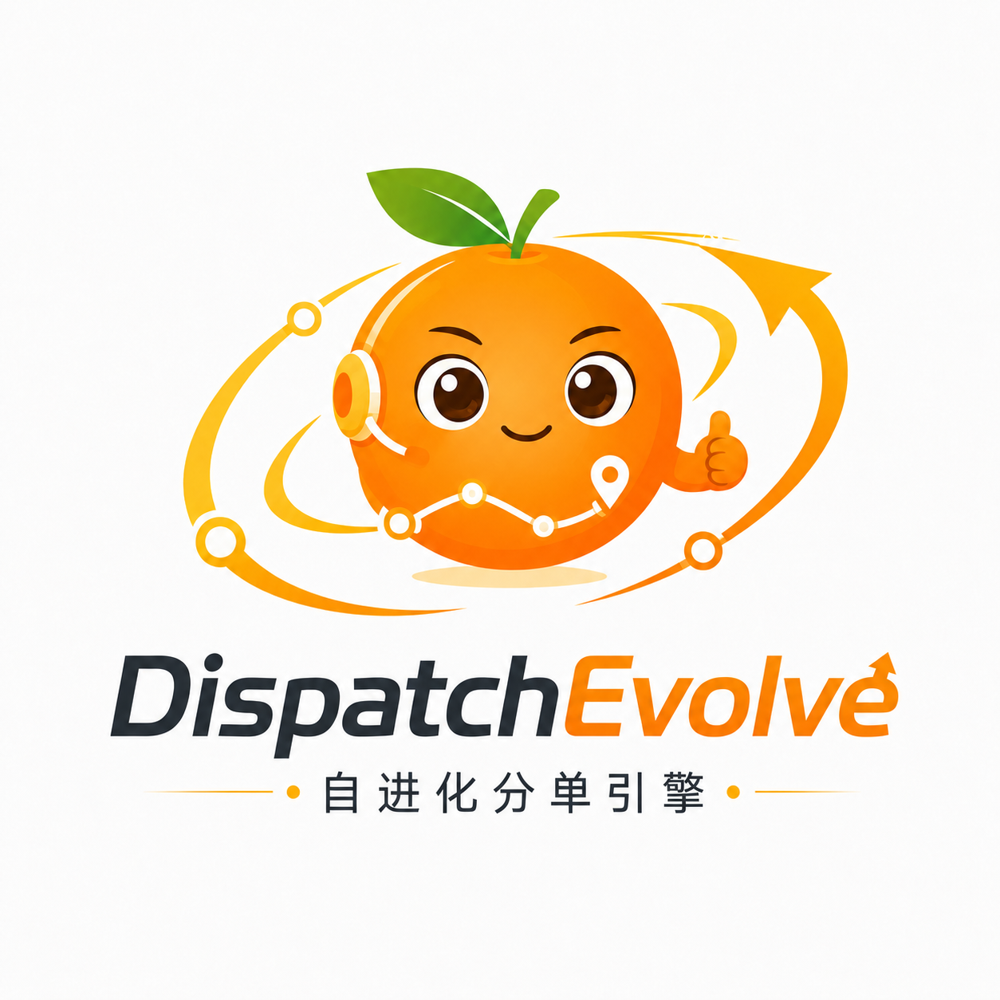
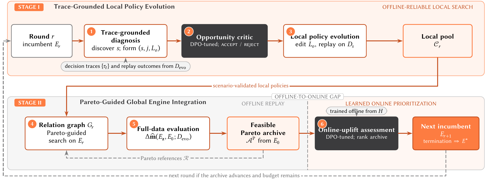

<div align="center">
  <p></p>
  <p>
    <a href="pyproject.toml"></a>
    <a href="LICENSE"></a>
  </p>
</div>

## Overview

Open-source code for the paper **DispatchEvolve: Autonomous Policy Evolution for
Industrial Ride-Hailing Dispatch Engines with Multi-Objective Constraints**.

DispatchEvolve improves dispatch policies through two stages:

1. **Trace-Grounded Local Policy Evolution:** discover scenario-specific
   opportunities from decision traces, assess them with an Opportunity Critic,
   and evolve the relevant policies under local metric guardrails.
2. **Pareto-Guided Global Engine Integration:** analyze candidate interactions,
   evaluate complete-engine combinations, and select from a feasible Pareto
   archive using an online-uplift assessor.



## Quick start

From the directory containing this README and `pyproject.toml`:

```bash
uv sync --locked --extra dev
uv run python -m dispatchevolve.synthetic_demo
```

The example generates separate evolution and test inputs and runs the workflow
with scripted model responses. Results are saved to
`workspaces/synthetic_demo/summary.json`. See the [example](examples/synthetic_engine/README.md)
for its setup and expected output.

Candidate execution requires macOS Sandbox or Linux Landlock ABI 3 or newer.

## Model configuration

To run the example with a model endpoint:

```bash
export OPENAI_API_KEY=your_key
uv run python -m dispatchevolve.synthetic_demo --live \
  --model your-model --api-base https://api.openai.com/v1 \
  --output-dir workspaces/live_demo
```

For separate generator and Critic endpoints, prepare the example inputs and edit
[configs/example.yaml](configs/example.yaml):

```bash
uv run python -m dispatchevolve.synthetic_demo --prepare-only \
  --output-dir workspaces/synthetic_inputs
uv run dispatchevolve --config configs/example.yaml
```

Set `model` for generation and evolution, `critic_model` for opportunity review,
and `online_model` for archive ranking. Each model accepts `provider`, `model`,
`api_base` and `api_key_env`. Configure trained Critic deployments for the two
assessment roles.

## Paper experiment settings

[configs/paper.yaml](configs/paper.yaml) provides the main-experiment template.
Configure the engine directory, evolution and test data paths, and model
endpoints. Evolution uses the training split; the selected engine is frozen
before evaluation on the held-out test split.

The template uses 10 outer rounds, up to 10 admitted opportunities per round,
14 Pareto references, and a shared budget of 30 full-replay equivalents. A full
evolution-set replay costs 1; local replay costs the fraction of evolution-set
rows replayed. Test evaluation is separate from this search budget.

`rho: 0.005` sets the BR relative regression tolerance to 0.5%.
Set `random_seed` and a distinct `run_id` for each experimental run.
The paper uses Gemini 3 Flash for generation and Qwen3-8B DPO critics;
replace the endpoint placeholders with your deployed model identifiers.

The public evaluator uses local bipartite matching. Paper experiments use the
production replay simulator. See [data fields and metric formulas](docs/public-data-model.md)
for input semantics, CR/BR definitions and FAI calculation.
Test metrics and the paper report are saved to `final/test_result.json` in the run
directory.

## Implementation

The main workflow is in
[src/dispatchevolve/workflows/dispatchevolve_v2/](src/dispatchevolve/workflows/dispatchevolve_v2/).
It includes scenario discovery, local policy evolution, candidate integration,
Pareto archiving and engine ranking. Runtime templates are in its
[prompts directory](src/dispatchevolve/workflows/dispatchevolve_v2/prompts/).
Local matching and candidate execution are in
[tasks/full_dispatch](src/dispatchevolve/tasks/full_dispatch/).

## Critic training

See [DPO data preparation and training](docs/critic-training.md) for constructing
preference datasets and training the Opportunity Critic and online-uplift
assessor with LLaMA-Factory. The training configurations are
[critic_dpo.yaml](configs/critic_dpo.yaml) and
[online_critic_dpo.yaml](configs/online_critic_dpo.yaml).

## Tests

```bash
uv run pytest test/workflow/ -q
```

Tests cover workflow execution, matching, metrics, replay budgets, policy tracing,
integration, candidate isolation and Critic data preparation.

## License

[Apache-2.0](LICENSE). See [third-party notices](THIRD_PARTY_NOTICES.md) for
component attribution.
